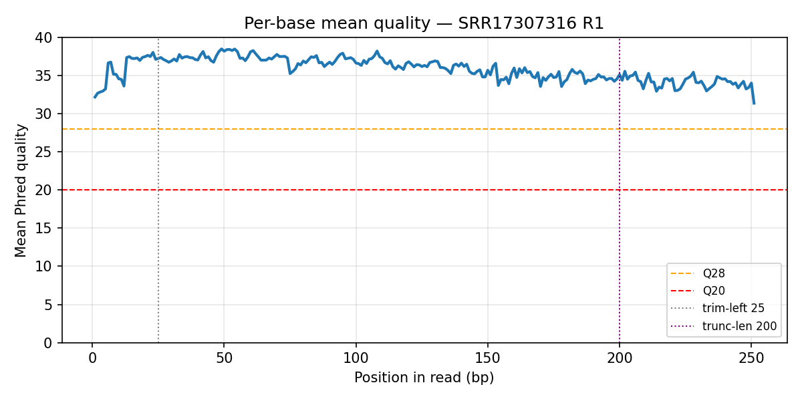
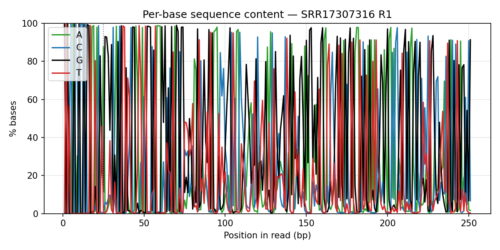

# Анализ влияния загрязнения почвы керосином на бактериальное сообщество

**ФИО:** Богданов Данил Русланович  
**Группа:** Б06-303б  
**Аккаунт Алдана:** `studfbmf01_15`  
**Сервер:** `calc.cod.phystech.edu`  
**ПО:** Qiime2 amplicon 2024.10 (Singularity)  
**Прогон:** SLURM job `119429`, partition `E5-2630-TITAN_X`, завершён 16.10.2026 23:35  
**Выборка:** учебный набор `soil_hw` (PRJNA786393), k0/k5/k25 × d3/d90/d180/d360 × 3 реплики

Файлы визуализации (https://view.qiime2.org):

| Файл | Задача |
|---|---|
| `qzv/soil_reads.dada2.stats.qzv` | 3 |
| `qzv/soil_taxonomy_barplot.qzv` | 5 |
| `qzv/weighted_unifrac_emperor.qzv` | 6 |
| `qzv/soil_shannon_significance.qzv` | 7 |

---

## Задача 1. FastQC

Взял R1 образца **AL_k0_r1_d3_p_V4V5_C** (`SRR17307316_1.fastq.gz`).

| Параметр | Значение |
|---|---|
| Число ридов | 108 335 |
| Длина | 251 bp |
| Средний GC | 57.4% |
| Средний Phred | ~35.8 |
| Phred: первые 25 / последние 50 nt | ~35.9 / ~34.1 |
| Оценка дубликатов | ~45% |
| N | ≈ 0% |

Профиль качества ровный и высокий (везде выше Q28), к 3′-концу спад слабый. Для DADA2 это как раз обосновывает `--p-trim-left 25` и `--p-trunc-len 200`.

Per-base content в начале рида «ломается» из‑за праймера **515F** — для ампликонов 16S это типичный Fail FastQC, а не плохой прогон. GC-распределение сдвинуто от 50% к ~57%.

---

## Задача 2. Зачем `--p-trim-left 25`?

Параметр срезает первые 25 оснований:

1. убирает праймер 515F (19 nt) и технические базы индексирующей ПЦР;
2. снимает праймерный перекос состава на 5′-конце (виден в FastQC);
3. вместе с trunc-len=200 делает длину ASV одинаковой для сравнения.

---

## Задача 3. Статистики фильтрации DADA2

По моему `soil_reads.dada2.stats.qzv` (36 образцов):

| Метрика | Значение |
|---|---|
| Доля после quality-filter | **~99.4%** (диапазон 97.93–99.88%) |
| Доля non-chimeric от input | **~94.9%** (89.4–97.08%) |
| Минимум non-chimeric | **4809** (`SRR17307380`) |
| Максимум non-chimeric | **43 518** (`SRR17307475`) |

Почти ничего не отсекается на quality-filter, после denoising+chimera остаётся ~90–97% — качество данных высокое. Глубины сильно различаются, поэтому в core-metrics я поставил `--p-sampling-depth 4568` (≈95% от минимума non-chimeric).

---

## Задача 4. Почему достаточно классификатора на V4?

Праймеры дают ампликон V4–V5, но пайплайн работает только с **R1**. После trim 25 и trunc 200 остаётся фрагмент ~175 bp, начинающийся с 515F — это по сути регион **V4**. Классификатор GreenGenes2 `backbone.v4` обучен именно на таких фрагментах. Полный V4–V5 имел бы смысл при склейке пар, а её в задании нет из‑за плохого качества концов R2.

---

## Задача 5. Таксономический barplot

Сортировка: `level_and_time_point`.

На **d3** все три нагрузки почти совпадают: смесь *Acidobacteriae*, *Alphaproteobacteria*, *Actinomycetia*, *Gammaproteobacteria*.

Со временем:
- **k0** остаётся «почвенным», *Acidobacteriae* даже усиливаются;
- **k5** временно сдвигается к *Gammaproteobacteria*, к d360 частично откатывается к контролю;
- **k25** уходит в доминирование *Gammaproteobacteria* (к d360 порядка ~85–90%).

На Level 6 в загрязнённых образцах главный род — **Paraburkholderia** (Burkholderiaceae). При сильном загрязнении к концу года он занимает подавляющую долю. Для керосина это ожидаемо: эти таксоны известны как деграданты углеводородов.

Скриншоты Level 3 и Level 6 — из `qzv/soil_taxonomy_barplot.qzv`.

---

## Задача 6. Weighted UniFrac (Emperor)

На d3 точки k0/k5/k25 лежат компактно вместе. Главная ось (**Axis 1**) разделяет образцы по силе загрязнения: k25 уходит дальше всего, k5 — между контролем и k25. По **Axis 2** виден временной дрейф.

Восстановление: у **k5** к d360 точки ближе к контролю; у **k25** возврата нет — сообщество фиксируется в новом состоянии.

Файл: `qzv/weighted_unifrac_emperor.qzv`.

---

## Задача 7. Индекс Шеннона

Средние Shannon после rarefaction (depth = 4568) из моего прогона:

| | d3 | d90 | d180 | d360 |
|---|---|---|---|---|
| **k0** | 8.99 | 8.87 | 8.63 | 8.27 |
| **k5** | 9.06 | 7.78 | 6.59 | 6.78 |
| **k25** | 8.92 | 7.61 | 5.91 | **2.95** |

Контроль снижается слабо. При k5 разнообразие падает, затем слегка поднимается. При k25 падение сильное и к году не компенсируется.

Файл: `qzv/soil_shannon_significance.qzv`.

---

## Краткий вывод

Слабое загрязнение (k5) обратимо частично; сильное (k25) упрощает сообщество вокруг *Paraburkholderia* / Gammaproteobacteria и удерживает низкое α-разнообразие до d360.
